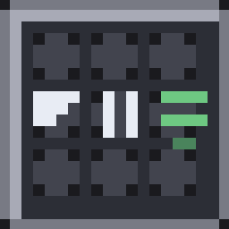

<p align="center">
  
</p>

<h1 align="center">Inventory Tweaks: Reloaded</h1>

<p align="center">Inventory Tweaks for <b>Minecraft 26.3 + NeoForge</b>, rebuilt from the 1.12.2 original.</p>

The original project is no longer updated. This is a port that keeps the way it
behaved: the buttons in the corner of every container, the R key, the middle
click, and a tool that quietly replaces itself when it breaks.

## What it does

**Container buttons.** Any container whose storage slots form a full rectangle
gets the classic four 10×10 buttons at `(xSize - 53, 5)`, `-41`, `-29`, `-17`:
default sort, vertical sort, horizontal sort, settings. Plain player-inventory
screens get only the settings button, exactly like the original.

**Sorting.** The 1.12.2 algorithm:

* rules are applied by priority, `D /LOCKED` and `FROZEN` block movement
* identical stacks merge before anything else
* the final pass repeatedly moves every remaining stack into the first slot it
  belongs to
* `DEFAULT`, `VERTICAL`, `HORIZONTAL` and `EVEN_STACKS` all behave as before
* the hotbar is locked during an inventory sort, so your tools stay put

Item order follows the creative-inventory order inside category bands (sword →
shield → bow → crossbow → trident → mace → arrows → pickaxes → shovels → axes →
hoes → shears → rods → helmets → chestplates → leggings → boots → food → blocks
→ resources). That covers modded items automatically, without a hardcoded item
list.

**Auto-refill.** When the selected hotbar stack runs out, the best matching
stack from the rest of the inventory is swapped in with a normal hotbar-swap
click. Tools match by item and by every component except the damage counter, so
a worn pickaxe is replaced by a fresh one of the same kind. With
`autoRefillBeforeBreak` enabled the swap happens just before the tool breaks
instead of after.

**Middle click.** Sorts the section under the cursor. On a chest it cycles
default → horizontal → vertical when clicked repeatedly within two seconds; on a
crafting grid it evens out the stacks, which is what the original did.

**R key.** Sorts the player inventory, both in the world and with a container
open. It is a normal key binding under **Options → Controls**, in its own
*Inventory Tweaks: Reloaded* section, so it can be rebound. The default is R.

## Compatibility

**No Mixin, no ASM, no server component.** Every item movement is an ordinary
container click produced by `MultiPlayerGameMode.handleContainerInput(...)` with
`ContainerInput.PICKUP` / `SWAP`. The server validates each click exactly as it
validates a player's, so the mod works in singleplayer, on a dedicated NeoForge
server (it is client-only and does not need to be installed server-side), and on
vanilla servers.

**Container detection is geometric, not positional.** Instead of assuming
"every slot before the player inventory is a chest", the mod groups the
non-player slots by their `y` coordinate and requires a complete, equally-wide
rectangle. A 3×3 dispenser, a 9×6 double chest and a modded 13×8 crate all
qualify; a machine whose slots are scattered into input/output clusters does
not, and is left alone rather than being scrambled.

**The cursor stack never lands in a container.** If you are carrying a stack
when you press a sort button, it is parked in your own inventory first. If your
inventory is full the sort aborts, instead of dumping your held item into
someone else's chest.

**Creative and spectator are excluded.** Those menus are not real storage, and
sorting them would duplicate or delete items.

## Configuration

`config/invtweaksreloaded-client.toml`, or the in-game "..." button.

| Key | Default | Meaning |
|---|---|---|
| `showChestButtons` | true | show the four buttons |
| `enableMiddleClick` | true | middle-click sorting |
| `enableAutoRefill` | true | replace used-up stacks |
| `autoRefillBeforeBreak` | false | swap before the tool breaks |
| `autoRefillDamageThreshold` | 5 | remaining durability that triggers it |
| `enableSounds` | true | click feedback |
| `enableAutoEquipArmor` | false | equip the best armor when sorting |
| `invertToolDamageSorting` | true | damaged tools first |

## Building

Requires JDK 25 (Minecraft 26.3 class files are major version 69).

```bash
cd mod
./gradlew build
```

The jar lands in `mod/build/libs/`. `./gradlew runClient` starts a dev client.

### Tests

```bash
cd mod
./gradlew test                # unit tests, no game required
./gradlew runClientSelftest -Pinvtweaksreloaded.world=<world folder>
```

The unit tests cover the rule grammar and the geometric container detector. The
end-to-end self test enters the named singleplayer world, seeds a known multiset
into a real inventory, sorts it through actual click packets, compares the
server's copy against the starting totals, and then exercises tool refill
through the real durability path.

## Layout

```
mod/src/main/java/com/mcfreegod/invtweaksreloaded/
  client/        key binding, button placement, middle click, entry point
  client/gui/    the 10x10 buttons and the settings screen
  config/        ModConfigSpec
  core/          container layout, click mover, sorting engine, rules, auto-refill
mod/src/test/java/  rule grammar and grid detection tests
```

## License

MIT. See [LICENSE](LICENSE).

This is a derivative of [Inventory Tweaks](https://github.com/Inventory-Tweaks/inventory-tweaks)
by Marwane Kalam-Alami (MIT, 2011-2013). The sorting algorithm, rule syntax,
button layout and auto-refill behaviour are ported from that codebase; the
NeoForge / Minecraft 26.3 implementation is new.

Parts of this codebase were written with AI assistance.
